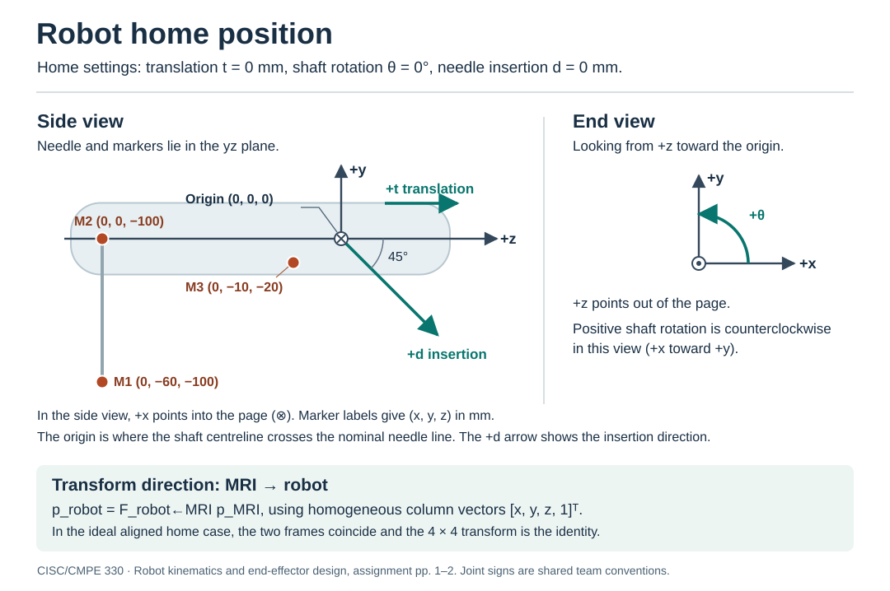

# CISC330_MRI-prostate-fla_F26
MRI-guided robotic focal laser ablation of prostate cancer

## Shared robot frame

Both parts use a right-handed robot frame. The origin $O=(0,0,0)$ is the point marked **Ctr** in the assignment, where the shaft centreline intersects the nominal needle line. In the side view, $+z$ points right along the shaft, $+y$ points up, and $+x$ points into the page.

### Home position and positive joint motions

At home, translation $t=0$ mm, shaft rotation $\theta=0^\circ$, and needle insertion $d=0$ mm.

| Joint | Positive motion |
|---|---|
| Translation $t$ | The end effector moves along $+z$. |
| Shaft rotation $\theta$ | The shaft rotates about $+z$ by the right-hand rule. Looking from $+z$ toward the origin, positive rotation is counterclockwise, from $+x$ toward $+y$. |
| Needle insertion $d$ | The needle advances along its guide. At zero shaft rotation, the guide lies in the $yz$ plane and points $45^\circ$ from $+z$ toward $-y$. |

### Marker coordinates

Use the order **M1, M2, M3** for localization and registration. These coordinates are fixed in the moving robot frame.

| Marker | $x$ (mm) | $y$ (mm) | $z$ (mm) |
|---|---:|---:|---:|
| M1 | 0 | −60 | −100 |
| M2 | 0 | 0 | −100 |
| M3 | 0 | −10 | −20 |

### MRI-to-robot transform

The $4\times4$ transform $F_{\mathrm{robot}\leftarrow\mathrm{MRI}}$ takes a point **from MRI coordinates into robot coordinates**. Both parts use homogeneous column vectors with entries $(x,y,z,1)$.

$$
\mathbf{p}_{\mathrm{robot}} =
F_{\mathrm{robot}\leftarrow\mathrm{MRI}}\,\mathbf{p}_{\mathrm{MRI}}.
$$

In the **ideal aligned home case**, the MRI and robot frames coincide. The transform is the identity $I_4$, and the MRI marker coordinates match the table above.
